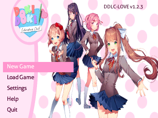

# FroggyDDLC

An unofficial, complete port of **Doki Doki Literature Club!** to the Data Frog
**GB300** and **SF2000** handhelds.

FroggyDDLC runs the full DDLC-LOVE 1.2.3 game data (all acts, poems, choices,
menus, saves and original assets) on a small LÖVE-SF2000 software runtime. It
does not require an operating system, SDL, OpenGL or a hardware FPU.

> This is a fan project. It is not affiliated with or endorsed by Team Salvato.
> Please support the official game: <https://ddlc.moe>.



## Download and install

Download the package for your console from the
[Releases](https://github.com/Synaps33/FroggyDDLC/releases/latest) page:

| Console | Package |
| --- | --- |
| GB300 | `FroggyDDLC-GB300.zip` |
| SF2000 | `FroggyDDLC-SF2000.zip` |

The packages contain the correct core, the complete game data, the launcher
stub, the game-list entry and the thumbnail.

1. Format the SD card as **FAT32**.
2. Extract the package to the **root** of the SD card and merge the folders.
3. Insert the card, open FrogUI and launch **`ROMS/ddlc/DDLC.gba`**.
4. If the entry is not visible, refresh/regenerate the ROM list in FrogUI.

No BIOS or additional runtime installation is required. The console must
already be running the multicore firmware used by FrogUI.

### Resulting SD layout

```text
system/Deimos/cores/ddlc.sf2k     core
cores/ddlc/core_87000000          core copy used by some launchers
ROMS/ddlc/                        game data
ROMS/ddlc/DDLC.gba                launcher stub
ROMS/ddlc/ddlc.sf2k               core copy next to the game
ROMS/ddlc/DDLC.rgb565             thumbnail
ROMS/DDLC.gba                     optional top-level shortcut
configs/custom_cores/ddlc/games.opt
```

The installer script from the repository can also do this automatically:

```bash
./install_to_sd.sh /media/<user>/<SD_CARD>
# Force a device if the mount path is ambiguous:
DEVICE=SF2000 ./install_to_sd.sh /media/<user>/<SD_CARD>
```

Existing save files in `ROMS/ddlc/` are not overwritten.

## Controls

| Button | Action |
| --- | --- |
| A | Advance text / confirm |
| B | Hide the text window / back / delete |
| Y | Open the pause menu / toggle Caps Lock in the name keyboard |
| X | Toggle the text outline |
| START | Toggle auto-forward |
| SELECT | Toggle the text outline |
| D-Pad | Move the selection / scroll |

The name-entry keyboard is a dedicated 320x240 screen with on-screen
`Space`, `Delete`, `Enter` and `Caps` keys.

## Saves

Saves are written next to the game data:

```text
ROMS/ddlc/persistent          player name and persistent choices
ROMS/ddlc/settings.sav        volume, text speed and language
ROMS/ddlc/saveXX-Y.sav        save slots
```

To start over, back up and delete `persistent` (and optionally the
`save*.sav` files). Deleting `persistent` makes the game ask for the player
name again on the next New Game.

## What is included

* All four DDLC acts, the poem minigame, choices, special events, history,
  save/load and settings.
* English and Spanish scripts from DDLC-LOVE 1.2.3.
* Original DDLC assets, pre-scaled for the 320x240 screen to reduce memory use.
* A 320x240 handheld UI: dialogue box, choices, pause, settings, save/load,
  history, help, poem list and a full-screen name keyboard.
* Streaming OGG music and sound effects with a 2-tap anti-alias resampler,
  exact 22.05 kHz output and a mono-friendly mix.
* Soft-float MIPS cores with **zero** hardware floating-point instructions.

### Why not Ren'Py?

DDLC was built with Ren'Py, which needs Python, SDL2 and an OpenGL/GLES
renderer. The SF2000/GB300 firmware provides none of these and has no hardware
FPU. A direct Ren'Py port would mean porting an operating system, Python, SDL
and a software GPU stack. FroggyDDLC instead runs the complete DDLC-LOVE game
data on the lightweight LÖVE-SF2000 runtime. The story, assets and menus are
the complete game; this is not a shortened remake.

## Building from source

### Prerequisites

* Linux with a 32-bit-capable GCC toolchain for the host tests.
* The `mipsel-mti-elf` Frog toolchain.
* The `sf2000_multicore` source tree and its patched BIOS assets.
* The DDLC assets, which are not stored in this Git repository.

The Makefile contains the toolchain and multicore paths at the top. Adjust
them if your checkout is elsewhere.

### Get the game assets

Download `FroggyDDLC-GameData.zip` from the release page and extract it in the
repository root. It creates the `game/` tree with `main.lua`, `assets/` and
all scripts. The Git repository already contains the Lua/engine code, so the
archive only needs to fill in the assets.

Alternatively, extract `ROMS/ddlc/` from a full device package and copy its
contents into `game/`.

### Host tests

```bash
make native          # native libretro core
make test            # autopilot; writes screenshots/
```

The host runner is useful for smoke tests, text wrapping, menu navigation and
WAV audio checks. It is not a substitute for testing on real hardware.

### Console cores

```bash
make gb300-core      # build/core_87000000_gb300v2
make sf2000-core     # build/core_87000000_sf2000
make dist            # dist/DDLC_GB300V2.gb3k + dist/DDLC_SF2000.sf2k
```

Both cores are linked with `-msoft-float`. To verify the GB300/SF2000
binaries:

```bash
mipsel-mti-elf-objdump -d build/core.elf | \
  grep -cE '\b(mul|add|sub|cvt|div)\.s|mtc1|mfc1|lwc1|swc1'
# expected: 0
```

The Makefile cleans the multicore build directory between device targets; do
not link the GB300 and SF2000 archives into one core.

## Technical notes

* Display: 320x240 RGB565, 4:3, 60 fps libretro timing.
* The original 1280x720 scenes are scaled to the panel. Handheld UI elements
  are drawn in physical pixels, not in the scaled 1280x720 space.
* Images are pre-scaled by 2x and drawn back at 2x to cut decode time and
  source-image memory by roughly 4x.
* Audio: 44.1 kHz OGG sources are resampled to 22.05 kHz with a 16.16
  fixed-point interpolator and a 2-tap anti-alias average when downsampling.
  The core emits 367 or 368 frames per video frame, averaging exactly
  22,050 Hz.
* The frontend mono mix sums left and right in 32 bits before shifting.
* Saves are plain Lua tables written through `love.filesystem`.

## Troubleshooting

**The game is not in the menu.**
Refresh the ROM list in FrogUI, or copy `ROMS/ddlc/DDLC.gba` again. Make sure
the core is at `system/Deimos/cores/ddlc.sf2k` and the data is in
`ROMS/ddlc/`.

**The game starts and returns to the menu.**
Check the core path and that `ROMS/ddlc/main.lua` exists. The core looks for
`main.lua` in the game directory.

**No sound.**
Set the console volume and the in-game volume in Settings. The game writes
`settings.sav` next to the data.

**Saves from an older install.**
The installer preserves `persistent`, `settings.sav` and `save*.sav`. To see
the name-entry screen again, back up and remove `persistent`.

**The image is stretched.**
The handheld panel is 4:3; the original 16:9 artwork is scaled to fill it. The
UI is laid out for 320x240.

## Credits and licenses

* **DDLC-LOVE** by LukeZGD and contributors — game scripts and port code,
  GNU GPL v3. This repository is a fork of the DDLC-LOVE code base:
  <https://github.com/LukeZGD/DDLC-LOVE>.
* **love-sf2000** and the SF2000/GB300 LÖVE runtime — the engine and
  libretro frontend foundation.
* **Doki Doki Literature Club!** and all characters, artwork, music and other
  assets — copyright Team Salvato. The assets are included for this
  non-commercial fan port and are not covered by the GPL.
* Lua 5.1 (MIT), miniz, stb_image, stb_truetype and stb_vorbis under their
  respective permissive licenses.

See `NOTICE.md` and `LICENSE` for details. This software is provided as-is,
without warranty of any kind.
